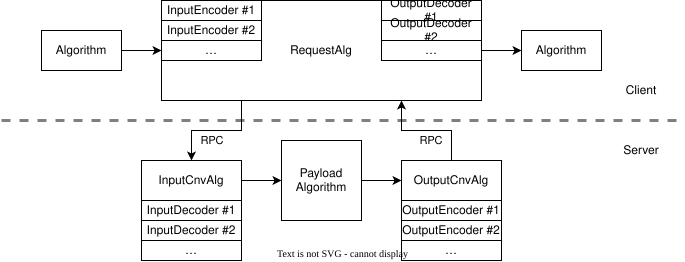

# AthRemoteExec

This directory contains packages with a core implementation of gRPC-based solution for remote execution of Athena code.

## `Control/AthRemoteExec/AthRemoteExecWire`

Header-only interface for RPC wire.

- Contains C++ interface of basic object used for RPC communication (`Protocol.h`).
- Interface for RPC client (`Client.h`) and server (`Server.h`).
- Interface for RPC request timing and implementation (`Timing.h` and `Timing.cxx`).

The rest needs to be implemented in a separate RPC package.

## `Control/AthRemoteExec/AthRemoteExecGrpc`

A gRPC implementation of `AthRemoteExecWire`.

- Conversions from gRPC types to C++ interface (`ProtocolConvert.h` and `Protocol.cxx`).
- Implementation of client and server interfaces from `AthRemoteExecWire` (`Client.cxx` and `Server.cxx`).
- Tests for conversions in `test/`

## `Control/AthRemoteExec/AthRemoteExecCore`

- Custom Hive-based EventLoopMgr (`RemoteExecHiveEventLoopMgr.h`), that deals with receiving request, checking their validity, preparing events and dispatching them to the scheduler, and replying back to client.
- Interface and base class for Codecs – tools responsible for encoding and decoding object data into bytes (`IPayloadCodec.h` and `PayloadCodecBase.h`). Each codec can handle only one type of data.
- The first server-side algorithm (`InputCnvAlg.h`), responsible for decoding data from request via appropriate Codecs.
- The last server-side algorithm (`OutputCnvAlg.h`), responsible for encoding data that needs to be sent back to client via appropriate Codecs.
- Client-side equivalent of `InputCnvAlg` and `OutputCnvAlg` (`RequestAlg.h`), encodes all requested data, waits for reply from server, and decodes returned data.
- Tests for the package are stored in `test/`.

## `Control/AthenaExamples/AthExRemoteExec`

- Examples of how to implement codecs (`AthExRemoteExec/src`), and how to configure and use them (`AthExRemoteExec/python`).
    - `DemoWordsCodec` shows an example of Codec using existing proto schema. This codec and its configuration should be treated as a "Hello, World!" for writing new Codecs.
    - `DemoIntsCodec`/`DemoDoublesCodec` are Codecs that define new proto schema, which needs to be compiled. `DemoIntsCodec` also shows how to use `HandleKeyArray`s.
- Script that runs the demo: `share/remote_exec_run_demo.sh`

Visual representation of how parts work with each other:

