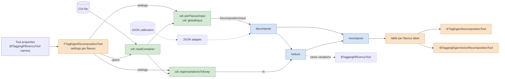

# FTagEigenVariations

New implementation of the eigenvector decomposition of the flavour tagging scale factor
uncertainties. It is developed next to the current one in `CalibrationDataInterface` and
`xAODBTaggingEfficiency`, which it will replace once validated.

The core library `FTagEigenVariationsLib` (namespace `ftag::ev`) depends only on Eigen. It
works on plain per-bin numbers, so any calibration format can feed it through an adapter.

## Overview

Blue is the core (`FTagEigenVariationsLib`), green the CDI adapter
(`FTagEigenVariationsCDILib`), orange the recomposition tool (`FTagEigenVariationsToolLib`).
Dashed parts are planned: a JSON adapter, and the BTaggingEfficiencyTool applying the
variations of this core, so that the recomposition describes the variations analyses get.

## Decomposition

`ftag::ev::decompose` takes one or more flavour blocks (the per-flavour strategy uses one,
the global strategy all of them) and a list of uncertainty sources:

* each block gives the statistical covariance of its scale factors;
* each source gives its shift of the scale factor per bin, in every block it affects;
* a source is either correlated across all bins, or comes with a group id per bin: bins
  with the same id are correlated, bins with different ids are not. A grouped source is
  split into one source per group, named `<source>_bin<id>`.

The total covariance over all bins of all blocks is

    V = V_stat + sum_s d_s d_s^T

with `d_s` the shift vector of source `s`. Its eigenvectors `u_k` with eigenvalues
`lambda_k` give the independent variations `sqrt(lambda_k) u_k`, which add back up to `V`.

Conventions:

* eigenvalues are sorted in descending order;
* eigenvalues at or below `1e-12` times the largest one are dropped;
* the largest entry (in absolute value) of each `u_k` is positive;
* bins without any uncertainty are kept out of the solve, so the variations are exactly
  zero there;
* sources named in `excluded` are left out of the covariance;
* inconsistent input throws `std::invalid_argument`.

## Reduction

`ftag::ev::reduce` keeps the leading `m - 1` eigenvariations and replaces the others by
one variation, so that Medium and Tight analyses get `m` nuisance parameters. In every bin
`u`, the merged variation is

    e_merged(u) = s(u) * sqrt(sum_{j merged} e_j(u)^2)

with `s(u)` the sign of the leading merged eigenvariation in that bin. Every bin keeps its
full uncertainty, while the correlations between bins are approximated. Loose keeps all
eigenvariations, which is the same as `m` at least their number.

`ftag::ev::reductionQuality` compares any set of variations with the full covariance: the
uncertainty kept in each bin, and the largest change of a bin-to-bin correlation.

## Recomposition

`ftag::ev::recompose` writes each source as a combination of the variations, by least
squares over all variations together. The coefficients then express each eigenvector
nuisance parameter in terms of the sources. Without reduction and without statistical
uncertainty this is exact. For each variation, `describedFraction` is the sum of its squared
coefficients: without reduction it is 1 minus its statistical part, and after a merge it can
also exceed 1, since the merged variation is not independent of the kept ones.

## Names

`ftag::ev::eigenName` and `ftag::ev::sourceName` give the systematic names the
BTaggingEfficiencyTool uses: `FT_EFF_Eigen_<flavour>_<k>`, and `FT_EFF_<source>` with spaces
replaced by `_`.

## CDI files

`FTagEigenVariationsCDILib` (namespace `ftag::ev::cdi`) reads a scale factor container of a
CDI file into the inputs of the decomposition, the way the BTaggingEfficiencyTool reads it
today:

* `readContainer` takes the bins without under- and overflow, one shift per uncertainty
  entry, and the statistical covariance from the `statistics` matrix if there is one, else
  none if the statistical uncertainty is stored as `stat_np` variations, else the bin errors.
  A source that is not correlated between bins stays correlated between tag weight bins.
  `extrapolation from charm` is not a source: the BTaggingEfficiencyTool gives it to tau
  jets as a systematic of its own;
* `perFlavourInput` and `globalInput` apply the exclusions given per flavour label (a
  trailing `*` matches by prefix), and the recommended ones of the file if requested.
  Exclusions that match no source are ignored;
* `eigenvariationsToKeep` gives the number of eigenvariations kept by the reduction given
  for the flavour label, from the `ReducedSets` of the file.

The settings are given per flavour label, tau jets included. The rules the
BTaggingEfficiencyTool adds (tau jets take the charm settings, the high-pT extrapolation
uncertainties are excluded for continuous working points) are applied by the tool that fills
them.

For the global strategy, the sources of all flavours with the same name become one source.
Names that differ only by a leading `FT_EFF_` count as the same, since some calibrations add
the prefix and others don't (charm uses the light uncertainties `FT_EFF_Generator` as
`Generator`); the source takes the prefixed name. The statistical uncertainties and the sources
that are not correlated between bins stay uncorrelated between flavours.

## Recomposition tool

`ftag::ev::FTagEigenRecompositionTool` (interface `ftag::ev::IFTagEigenRecompositionTool`)
gives analyses the recomposition of the eigenvector nuisance parameters of a CDI file. It is
**not recommended yet**: until the BTaggingEfficiencyTool uses this decomposition, its
eigenvariations differ from the ones described here, and the tool warns about it.

It takes the BTaggingEfficiencyTool properties of the same name: `ScaleFactorFileName`,
`TaggerName`, `OperatingPoint`, `JetAuthor`, `SystematicsStrategy` (`SFEigen` or
`SFGlobalEigen`), `ScaleFactor{B,C,T,Light}Calibration`, `EigenvectorReduction{B,C,Light}`,
`ExcludeFromEigenVectorTreatment`, `ExcludeFromEigenVector{B,C,Light}Treatment`,
`ExcludeRecommendedFromEigenVectorTreatment`, `Uncertainty{B,C,T,Light}Suffix` and
`splitTauCharmEff`. Everything is computed in `initialize()`, which fails for a wrong
configuration, including an exclusion without `*` that matches no uncertainty of the
flavours it applies to.

The tool fills the settings of the CDI adapter as the BTaggingEfficiencyTool does: tau jets
take the charm exclusions and reduction, and for continuous working points the high-pT
extrapolation uncertainties (`extrapolation_pt_<b,c,l>_Eigen*`) are not decomposed.

`recomposition(label)` returns, for `B`, `C`, `T` or `Light`, the nuisance parameter names as
the BTaggingEfficiencyTool names them, the source names, the coefficients and the described
fractions. Tau jets share the charm table, and its names, unless `splitTauCharmEff` is set.
With `SFGlobalEigen`, which supports Loose only, each eigenvariation acts on all flavours
together, so every flavour label gives the same table, named `FT_EFF_Eigen_Global_<k>` without
suffix. Tau jets take the charm part of the global decomposition unless `splitTauCharmEff` is
set. The BTaggingEfficiencyTool names them per flavour today (`FT_EFF_Eigen_B_<k>`, ...), which
loses the correlation between flavours, and moves to these names at the switch.

The tool also implements `IBTaggingEigenVectorRecompositionTool`, the interface of the
current `BTaggingEigenVectorRecompositionTool`, with its conventions: keys `Eigen_<label>_<k>`
(`Eigen_Global_<k>` with `SFGlobalEigen`), source names as in the CDI file, and float
coefficients. It applies no systematic variations. An unknown label or eigenvector index throws
`std::invalid_argument`.

`FTagEigenRecompositionToolTester <CDI file> <tagger> <jet collection> <operating point>
<strategy>` prints a summary.

## Tests

The unit tests in `test/` check the decomposition, reduction, recomposition and names on
small inputs with known answers, and the CDI reading on a synthetic container.
`gt_CompareCurrentImplementation` runs the current and the new implementation side by side
on the CDI files used in CI: it checks that the covariance and the Loose eigenvariations
agree, and prints the per-bin uncertainty kept by the old and the new Medium and Tight
merge. For the global strategy, it checks that the eigenvariations add up to the covariance
built from the sources of each flavour, including the parts that correlate different flavours.
It also runs in the CI of merge requests that change `CalibrationDataInterface`.
`gt_FTagEigenRecompositionTool` checks the tool against the core on one of these files, for
both strategies, both interfaces, and its configuration errors; like the tester, it runs in
AnalysisBase, AthAnalysis and Athena. Run them with `ctest -R FTagEigenVariations` from the
build directory.
